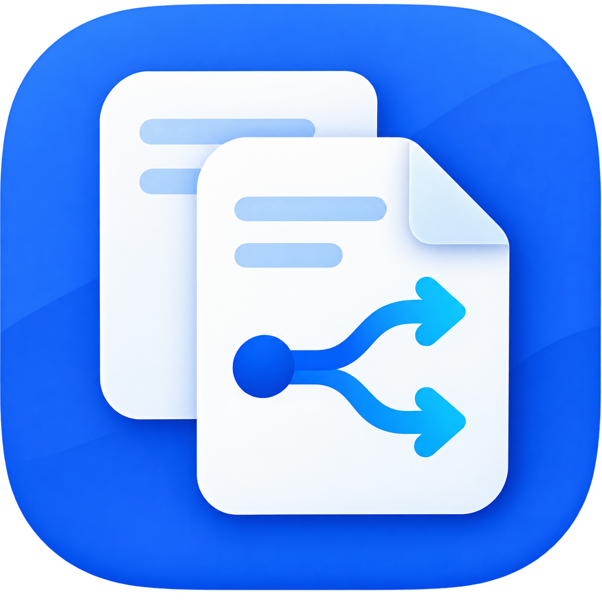

# PDF Toolbox



[Polski](#polski) · [English](#english)

---

## Polski

### Czym jest PDF Toolbox?

PDF Toolbox to bezpłatna aplikacja desktopowa dla Windows do podstawowej pracy z dokumentami PDF. Została napisana w C# z użyciem .NET 8 i Windows Forms.

Aplikacja działa całkowicie lokalnie i nie wymaga połączenia z Internetem. Dokumenty nie są przesyłane do chmury ani zewnętrznych usług. Program nie zawiera telemetrii, analityki ani internetowego raportowania błędów.

### Dostępne funkcje

- podział jednego PDF na osobny plik dla każdej strony,
- połączenie kilku PDF-ów w jeden dokument z możliwością zmiany kolejności,
- zapisanie tylko wybranych stron,
- utworzenie kopii bez wybranych stron,
- obrót wszystkich lub wybranych stron,
- sekwencyjny podział wielu dokumentów,
- przeciąganie plików metodą drag & drop,
- pasek postępu i bezpieczne anulowanie,
- automatyczne rozwiązywanie konfliktów nazw bez nadpisywania plików,
- ostrzeganie o wykrytych polach podpisu elektronicznego.

Oryginalne dokumenty nigdy nie są modyfikowane ani usuwane.

### Wymagania

Do budowania projektu:

- Windows 10 lub Windows 11 x64,
- [.NET SDK 8](https://dotnet.microsoft.com/download/dotnet/8.0),
- opcjonalnie Visual Studio 2022 z komponentem „Programowanie aplikacji klasycznych dla platformy .NET”.

Użytkownik gotowego, opublikowanego EXE nie potrzebuje Visual Studio, .NET SDK, środowiska .NET ani dodatkowych programów.

### Jak zbudować projekt?

Otwórz PowerShell i przejdź do katalogu projektu:

```powershell
cd C:\Users\Kacper\Desktop\PDFSplitter
```

Następnie wykonaj:

```powershell
dotnet restore
dotnet build -c Release
dotnet test -c Release
```

### Jak wygenerować pojedynczy EXE?

W katalogu głównym projektu wykonaj:

```powershell
dotnet publish src\PdfToolbox.WinForms\PdfToolbox.WinForms.csproj -c Release -r win-x64 --self-contained true
```

Gotowa aplikacja znajdzie się w:

```text
src\PdfToolbox.WinForms\bin\Release\net8.0-windows\win-x64\publish\PdfToolbox.exe
```

Publikacja jest:

- przeznaczona dla Windows x64,
- self-contained — zawiera wymagane środowisko .NET 8,
- przygotowana jako pojedynczy plik `PdfToolbox.exe`,
- gotowa do skopiowania na komputer użytkownika.

W folderze `publish` należy przekazać użytkownikowi plik `PdfToolbox.exe`. Nie trzeba instalować .NET, Ghostscript, Pythona ani innych narzędzi.

### Uruchamianie w Visual Studio

1. Otwórz `PdfToolbox.sln`.
2. Ustaw `PdfToolbox.WinForms` jako projekt startowy.
3. Naciśnij F5 albo wybierz „Rozpocznij debugowanie”.

### Prywatność

> PDF Toolbox działa całkowicie lokalnie. Dokumenty nie są wysyłane do Internetu ani żadnych usług zewnętrznych.

- brak kodu wykonującego requesty HTTP,
- brak telemetrii, analytics i internetowych raportów awarii,
- brak analizowania lub indeksowania tekstu dokumentów,
- brak zapisywania treści PDF w logach,
- pliki częściowe są usuwane po błędzie lub anulowaniu,
- log lokalny nie zawiera nazw ani ścieżek dokumentów.

Logi techniczne są zapisywane w:

```text
%LocalAppData%\PdfToolbox\Logs\
```

### Podpisy elektroniczne

> Modyfikacja podpisanego dokumentu PDF może spowodować utratę ważności istniejącego podpisu. PDF Toolbox zawsze tworzy nowy dokument i nie modyfikuje oryginału.

Program sprawdza obecność pól podpisu typu `Sig` i wyświetla ostrzeżenie przed operacją. Jest to wykrywanie pomocnicze, a nie kryptograficzna weryfikacja podpisu. Niektóre nietypowe podpisy mogą nie zostać rozpoznane.

### Dokumenty zabezpieczone

PDF Toolbox nie łamie haseł, nie usuwa zabezpieczeń i nie omija ograniczeń dokumentów. Jeżeli PDF nie może zostać bezpiecznie otwarty przez bibliotekę, operacja zostanie przerwana, a użytkownik zobaczy czytelny komunikat.

### Biblioteki i licencje

| Składnik | Wersja | Licencja | Zastosowanie |
|---|---:|---|---|
| PDF Toolbox | 1.0.0 | MIT | Kod aplikacji |
| .NET / Windows Forms | 8 | MIT | Środowisko uruchomieniowe i interfejs |
| PDFsharp | 6.2.4 | MIT | Odczyt, importowanie i zapis stron PDF |
| xUnit | 2.9.3 | Apache-2.0 | Testy — nie jest częścią opublikowanej aplikacji |
| xunit.runner.visualstudio | 3.1.4 | Apache-2.0 | Uruchamianie testów |
| Microsoft.NET.Test.Sdk | 17.13.0 | MIT | Infrastruktura testowa |

Zależności przechodnie PDFsharp, między innymi `Microsoft.Extensions.*` i `System.Security.Cryptography.Pkcs`, są dostępne na licencji MIT. Przechodnie komponenty xUnit są dostępne na licencji Apache-2.0. Pełniejszy wykaz znajduje się w [THIRD-PARTY-NOTICES.md](THIRD-PARTY-NOTICES.md).

Projekt jest udostępniany na licencji MIT — zobacz [LICENSE](LICENSE).

### Ograniczenia

- chronione lub zaszyfrowane PDF-y mogą nie zostać otwarte,
- wykrywanie pól podpisu nie zastępuje weryfikacji kryptograficznej,
- operacje modyfikujące strukturę dokumentu mogą unieważnić istniejący podpis,
- aplikacja nie obsługuje OCR, kompresji, edycji tekstu ani podpisywania PDF,
- bardzo duże lub nietypowo skonstruowane PDF-y mogą być ograniczone możliwościami PDFsharp i dostępną pamięcią.

### Struktura projektu

```text
PdfToolbox.sln
src/PdfToolbox.WinForms/
  Assets/                   ikona aplikacji
  Controls/                 karty operacji, drag & drop i widok postępu
  Forms/                    główne okno i kreatory operacji
  Helpers/                  parser zakresów stron
  Models/                   modele dokumentów i operacji
  Services/                 operacje PDF, walidacja i pliki
  Infrastructure/Logging/   lokalne logowanie techniczne
tests/PdfToolbox.Tests/      testy jednostkowe i integracyjne
```

---

## English

### What is PDF Toolbox?

PDF Toolbox is a free Windows desktop application for basic PDF document operations. It is written in C# using .NET 8 and Windows Forms.

The application works entirely offline. Documents are not uploaded to the cloud or any external service. The program contains no telemetry, analytics, or online crash reporting.

### Features

- split one PDF into a separate file for every page,
- combine multiple PDFs into one document and reorder them,
- save only selected pages,
- create a copy without selected pages,
- rotate all pages or selected pages,
- sequentially split multiple documents,
- drag-and-drop file selection,
- progress reporting and safe cancellation,
- automatic filename conflict handling without overwriting files,
- warnings when electronic-signature fields are detected.

Original documents are never modified or deleted.

### Requirements

To build the project:

- Windows 10 or Windows 11 x64,
- [.NET SDK 8](https://dotnet.microsoft.com/download/dotnet/8.0),
- optionally Visual Studio 2022 with the “.NET desktop development” workload.

Users of the published EXE do not need Visual Studio, the .NET SDK, a separately installed .NET runtime, or any additional programs.

### How to build the project

Open PowerShell and navigate to the project directory:

```powershell
cd C:\Users\Kacper\Desktop\PDFSplitter
```

Then run:

```powershell
dotnet restore
dotnet build -c Release
dotnet test -c Release
```

### How to generate a single EXE

Run this command from the project root:

```powershell
dotnet publish src\PdfToolbox.WinForms\PdfToolbox.WinForms.csproj -c Release -r win-x64 --self-contained true
```

The finished application will be created at:

```text
src\PdfToolbox.WinForms\bin\Release\net8.0-windows\win-x64\publish\PdfToolbox.exe
```

The published application is:

- built for Windows x64,
- self-contained and includes the required .NET 8 runtime,
- packaged as a single `PdfToolbox.exe` file,
- ready to copy to an end user's computer.

Give the user the `PdfToolbox.exe` file from the `publish` directory. They do not need to install .NET, Ghostscript, Python, or any other tools.

### Running in Visual Studio

1. Open `PdfToolbox.sln`.
2. Set `PdfToolbox.WinForms` as the startup project.
3. Press F5 or select “Start Debugging”.

### Privacy

> PDF Toolbox works entirely offline. Documents are not sent to the Internet or any external service.

- no HTTP request code,
- no telemetry, analytics, or online crash reports,
- no analysis or indexing of document text,
- no PDF content stored in logs,
- partial files are removed after errors or cancellation,
- local logs do not contain document names or paths.

Technical logs are stored in:

```text
%LocalAppData%\PdfToolbox\Logs\
```

### Electronic signatures

> Modifying a signed PDF may invalidate its existing electronic signature. PDF Toolbox always creates a new document and never modifies the original.

The program checks for `Sig` signature fields and displays a warning before an operation. This is a helpful detection mechanism, not cryptographic signature verification. Some unusual signatures may not be detected.

### Protected documents

PDF Toolbox does not crack passwords, remove protection, or bypass document restrictions. If the PDF library cannot safely open a document, the operation is stopped and a clear message is displayed.

### Libraries and licenses

| Component | Version | License | Purpose |
|---|---:|---|---|
| PDF Toolbox | 1.0.0 | MIT | Application source code |
| .NET / Windows Forms | 8 | MIT | Runtime and user interface |
| PDFsharp | 6.2.4 | MIT | Reading, importing, and writing PDF pages |
| xUnit | 2.9.3 | Apache-2.0 | Tests; not included in the published application |
| xunit.runner.visualstudio | 3.1.4 | Apache-2.0 | Test runner |
| Microsoft.NET.Test.Sdk | 17.13.0 | MIT | Test infrastructure |

PDFsharp's transitive dependencies, including `Microsoft.Extensions.*` and `System.Security.Cryptography.Pkcs`, use the MIT License. Transitive xUnit components use the Apache License 2.0. See [THIRD-PARTY-NOTICES.md](THIRD-PARTY-NOTICES.md) for a more complete list.

This project is released under the MIT License — see [LICENSE](LICENSE).

### Limitations

- protected or encrypted PDFs may not be opened,
- signature-field detection is not a replacement for cryptographic verification,
- operations that modify the document structure may invalidate existing signatures,
- the application does not provide OCR, compression, text editing, or PDF signing,
- extremely large or unusually constructed PDFs may be limited by PDFsharp and available memory.

### Project structure

```text
PdfToolbox.sln
src/PdfToolbox.WinForms/
  Assets/                   application icon
  Controls/                 operation cards, drag and drop, and progress view
  Forms/                    main window and operation wizards
  Helpers/                  page-range parser
  Models/                   document and operation models
  Services/                 PDF operations, validation, and file handling
  Infrastructure/Logging/   local technical logging
tests/PdfToolbox.Tests/      unit and integration tests
```
